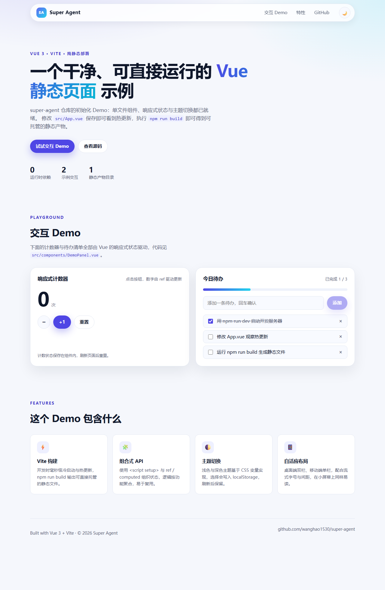

# Super Agent

一个使用 **Vue 3 + Vite** 构建的静态页面 Demo，作为 `super-agent` 仓库的初始化示例。

页面包含响应式计数器、待办清单和明暗主题切换，构建产物是纯静态文件，可以直接部署到任意静态托管服务。



## 快速开始

需要 Node.js 20.19+（推荐 22+）。

```bash
# 安装依赖
npm install

# 启动开发服务器（默认 http://localhost:5173）
npm run dev

# 构建静态产物到 dist/
npm run build

# 本地预览构建产物（默认 http://localhost:4173）
npm run preview
```

## 项目结构

```text
.
├── index.html                 # 页面入口
├── public/
│   └── favicon.svg            # 站点图标
├── src/
│   ├── main.js                # 应用入口
│   ├── App.vue                # 页面骨架、主题切换与内容区块
│   ├── assets/main.css        # 全局样式与明暗主题变量
│   └── components/
│       └── DemoPanel.vue      # 计数器与待办清单
├── vite.config.js
└── .github/workflows/         # CI 构建与 GitHub Pages 部署
```

## 实现要点

- **组合式 API**：所有状态使用 `<script setup>` 与 `ref` / `computed` 组织。
- **主题切换**：基于 CSS 自定义属性实现，选择写入 `localStorage` 并尊重系统偏好。
- **相对路径构建**：`vite.config.js` 中设置 `base: './'`，构建产物可部署在域名根路径或子路径。
- **响应式布局**：桌面端双栏、移动端单栏。

## 部署

推送到 `main` 分支后，[GitHub Pages 工作流](.github/workflows/deploy.yml) 会自动构建并发布页面，地址为：

<https://wanghao1530.github.io/super-agent/>
